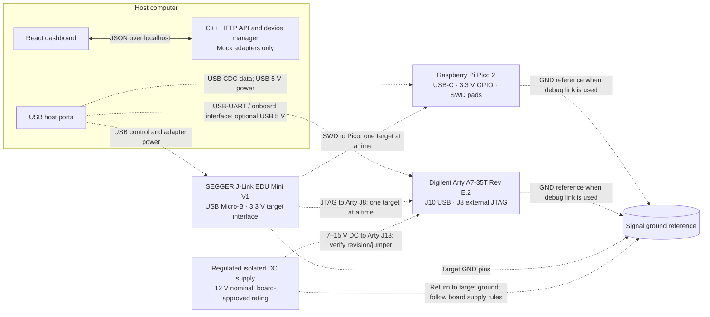

# Task E: host-connected embedded hardware design

## Status and selected assumptions

The hardware dashboard and C++ adapters in this project are **simulations**. They do not enumerate USB devices, assert GPIO/SWD/JTAG signals, read a sensor, upload firmware, configure an FPGA, or prove that a physical board is attached.

The reference design uses these representative products so that connector, power and logic assumptions can be discussed concretely:

1. **Microcontroller:** Raspberry Pi Pico 2 / RP2350, USB-C board variant, SWD pads exposed.
2. **FPGA:** Digilent Arty A7-35T, Rev E.2 schematic and external J8 JTAG header assumption.
3. **Debug adapter:** SEGGER J-Link EDU Mini V1, USB Micro-B host connection and 9-position (one key position absent) target connector.

These are representative assumptions, not a bill of materials or a verified compatibility statement for arbitrary revisions. Check the board marking and its matching schematic before wiring. The Pico family documentation describes USB/VSYS power, 3.3 V I/O, and the three SWD signals. The Arty E.2 schematic identifies J8 signals and its VCC3V3/GND pins. SEGGER documents the Mini target interface as 3.3 V and its target VTref/GND/signal convention. See [Raspberry Pi Pico-series documentation](https://www.raspberrypi.com/documentation/microcontrollers/pico-series.html), [Pico 2 datasheet](https://datasheets.raspberrypi.com/pico/pico-2-datasheet.pdf), [Digilent Arty A7 Rev E.2 schematic](https://digilent.com/reference/_media/programmable-logic/arty-a7/arty-a7-e2-sch.pdf), [Arty A7 reference manual](https://digilent.com/reference/programmable-logic/arty-a7/reference-manual), [J-Link EDU Mini specifications](https://kb.segger.com/J-Link_EDU_Mini_V1), and [SEGGER 9-pin JTAG/SWD connector](https://kb.segger.com/9-pin_JTAG/SWD_connector).

## Labelled connection block diagram

The solid software relationships below are what this implementation simulates. Dashed lines show a possible physical bench topology only; they do not indicate connected hardware.

Do not connect the adapter to both target connectors simultaneously. Route its target cable to exactly one target at a time. The Arty also has an on-board USB/JTAG path at J10; do not allow two active debug masters to drive the same TAP. Select one debug path and verify the board configuration. The Pico 2 target uses **SWD**, not JTAG.

## Interface and pin-voltage table

| Device | Connector | Power input | Ground | Voltage domain | Logic voltage | Communication protocol | Level shifting | JTAG signal ownership | Pinout assumptions |
|---|---|---|---|---|---|---|---|---|---|
| Host computer | USB host ports; local TCP socket for software API | Host AC adapter; USB VBUS nominal 5 V output subject to port limits | USB signal ground; host chassis/protective earth rules are host-specific | USB 5 V and host internal rails | USB differential signaling; no direct GPIO assumption | USB 2.0; HTTP/JSON on localhost | USB signaling is not GPIO level translation | Host only initiates software requests; the debug adapter owns target clocks/data outputs | USB port and power budget are host-specific; do not use the host as an assumed bench supply |
| Raspberry Pi Pico 2 / RP2350 | USB-C; exposed three-pad SWD interface | USB VBUS nominal 5 V or VSYS 1.8–5.5 V; regulated board rail | Pico GND; common signal reference to J-Link during SWD | VSYS input and regulated 3.3 V GPIO domain | 3.3 V GPIO; do not apply 5 V GPIO signals | USB CDC serial; SWDIO/SWCLK for debug | None for verified 3.3 V adapter-to-target SWD; translate other voltage domains | SWD adapter supplies SWCLK; SWDIO is bidirectional; target returns SWD response. No MCU JTAG assumed. | SWD pins are SWDIO, GND, SWCLK on three pads. Pad order/orientation is to be verified on the exact board; no numbered header mapping is assumed. |
| Digilent Arty A7-35T Rev E.2 | J10 Micro-USB; J8 external 1×6 JTAG; Pmod JA–JD | J10 USB nominal 5 V or J13 center-positive 7–15 V DC input as described for the board revision | Arty GND; connect adapter target GND when using J8 | Board rails include regulated 3.3 V I/O plus lower FPGA core/auxiliary rails | J8 reference and selected Pmod bank assumed 3.3 V for Rev E.2 | USB-UART through J10; four-wire JTAG via J8 | None for a verified 3.3 V JTAG adapter link; translate Pmod signals for incompatible external logic | External adapter drives TCK/TMS/TDI; FPGA returns TDO. J8 pin 6 VCC3V3 is target reference, **not a supply for the adapter**. Use one JTAG master. | Rev E.2 J8: 1 TMS, 2 TDI, 3 TDO, 4 TCK, 5 GND, 6 VCC3V3. Confirm revision before using. Pmod pin assignments require the matching board XDC/schematic. |
| SEGGER J-Link EDU Mini V1 | USB Micro-B host; target connector with nine physical contacts / keyed absent position | USB-powered; target is powered separately | Target GND pins 3 and 5 must share reference ground | Fixed 3.3 V target interface assumption | 3.3 V target signaling only | USB 2.0; JTAG or SWD | No translation assumed in this setup; do not attach to a target outside its specified interface voltage | Probe drives TCK/TMS/TDI (or SWCLK/SWDIO); samples TDO/SWO; VTref is an input sense line and is not target power | SEGGER numbering convention: 1 VTref, 2 TMS/SWDIO, 3/5 GND, 4 TCK/SWCLK, 6 TDO/SWO, 8 TDI, 9 NC/TRST option, 10 nRESET (with position 7 absent). Confirm the exact probe/cable revision. |
| Regulated bench supply | Center-positive coaxial plug to Arty J13 | 12 V nominal; Arty documentation gives 7–15 V DC and a minimum 1 A supply (rating depends on configuration) | Negative return to the board’s specified return only; never substitute signal wire for protective earth | Isolated DC output assumed; isolation must be confirmed for the actual supply | Not a logic interface | DC power only | Not applicable | Does not own or drive JTAG | Plug size, polarity, input range, jumper position and current rating must match the exact board revision and load. |

The J-Link VTref connection is a voltage **sense/reference**. It must connect directly to the target I/O reference as documented, without a series resistor, and it does not power the target. For this assumed setup, Arty J8 pin 6 is the target reference and Pico VDD/3V3 is the reference for SWD. Never join two different supply outputs through VTref.

## Adapter implementation and API

The C++ core declares a common `DeviceAdapter` interface with discovery, capability-bearing snapshots, connect, disconnect and telemetry methods. `MicrocontrollerAdapter`, `FpgaAdapter` and `JtagDebugAdapter` implement it through a mutex-protected mock state model. The API exposes:

- `GET /api/hardware/devices` — discovers the three simulated devices and returns capabilities, assumptions, status and one simulated telemetry message each.
- `POST /api/hardware/devices/{id}/connect` — connect; pass `{"simulate_timeout":true}` to demonstrate a recoverable timeout.
- `POST /api/hardware/devices/{id}/disconnect` — disconnect a simulated adapter.

The injected timeout sets status to `error`, returns an error and retry action, and the next ordinary connect request succeeds. This demonstrates state recovery only; there is no physical timeout or reconnection attempt.

## Electrical safety and limitations

- Verify the exact board and debug-probe revisions, connector orientation, signal directions, jumper positions and manufacturer pin tables before making connections.
- Keep target I/O within the target bank’s voltage limits. The assumed Pico GPIO and Arty J8/Pmod signals are 3.3 V; the assumed J-Link EDU Mini target interface is 3.3 V. Do not infer 5 V tolerance from a 5 V power input.
- Add a suitable level translator when voltage domains do not match; choose directionality and open-drain behavior for the actual protocol. Do not connect incompatible domains directly.
- Connect a valid common signal ground for non-isolated debug/serial links. Avoid unintended ground loops; never bridge isolated supply outputs, protective earth and signal return without the system grounding plan.
- Power each target according to its own guide. Do not assume J-Link VTref powers a target, and do not parallel USB and external supply rails unless the board documentation explicitly allows that configuration.
- Use only one active JTAG master on an FPGA TAP. Check the Arty onboard JTAG path before using external J8.
- These adapters are mocks. No real device discovery, GPIO access, firmware deployment, FPGA bitstream programming, JTAG scan, electrical measurement, safety interlock or hardware validation is implemented.

## Tests

`workbench_hardware_tests` verifies three distinct device types are discoverable, capabilities and telemetry are present, connect/disconnect state transitions work, and a simulated timeout exposes an error/recovery action followed by successful reconnection.
